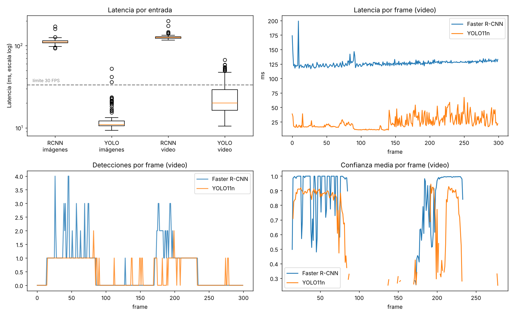

# Actividad 06 – Detección de objetos: Faster R-CNN vs YOLO

**Universidad Nacional del Altiplano Puno – Ingeniería de Sistemas**
**Visión Artificial – X ciclo, grupo B – Segunda unidad**

**Integrantes:** <!-- COMPLETAR: nombres del equipo -->

## 1. Objetivo

Comparar la detección de objetos con una aproximación de dos etapas (**Faster R-CNN**) y una de una sola etapa (**YOLO**), tanto en **imágenes** como en **video** (procesado cuadro por cuadro para simular tiempo real).

## 2. Contenido del repositorio

| Ítem | Descripción | Notebook | Resultados |
|---|---|---|---|
| A | Faster R-CNN en imágenes | `Actividad06_A_FasterRCNN_Imagenes.ipynb` | `metricas_imagenes_rcnn.csv`, `resumen_imagenes_rcnn.json` |
| B | YOLO en imágenes | `Actividad06_B_YOLO_Imagenes.ipynb` | `metricas_imagenes_yolo.csv`, `resumen_imagenes_yolo.json` |
| C | Faster R-CNN en video | `Actividad06_C_FasterRCNN_Video.ipynb` | `metricas_video_rcnn.csv`, `resumen_video_rcnn.json` |
| D | YOLO en video | `Actividad06_D_YOLO_Video.ipynb` | `metricas_video_yolo.csv`, `resumen_video_yolo.json` |
| E | Análisis de hallazgos | Sección 5 de este documento | `comparacion_rcnn_vs_yolo.png` |
| F | Informe-resumen | Este README | — |

## 3. Configuración experimental

Para que la comparación sea justa, los cuatro notebooks usan los mismos parámetros:

| Parámetro | Valor |
|---|---|
| Umbral de confianza (`CONF`) | 0.25 |
| Tamaño de entrada (`IMGSZ`) | 640 |
| Imágenes | COCO128 (128 imágenes con etiquetas) |
| Video | <!-- COMPLETAR: nombre, resolución y duración del video --> · 300 frames procesados |
| Modelo YOLO | YOLO11n (`yolo11n.pt`, ultralytics) <!-- confirmar --> |
| Modelo Faster R-CNN | ResNet50-FPN v2 (torchvision, pesos COCO) <!-- confirmar --> |
| Hardware | Google Colab, GPU <!-- COMPLETAR: p. ej. T4 --> |
| Latencia | Tiempo de extremo a extremo por entrada (preprocesamiento + inferencia + postprocesamiento), con *warm-up* previo |
| mAP | `torchmetrics` (mismo evaluador en A y B), con umbral bajo de 0.001 |

En video no hay etiquetas (*ground truth*), por lo que no se calcula mAP: se comparan velocidad, estabilidad y comportamiento de las detecciones.

## 4. Resultados

| Métrica | RCNN imágenes | YOLO imágenes | RCNN video | YOLO video |
|---|---:|---:|---:|---:|
| Entradas procesadas | 128 | 128 | 300 | 300 |
| Latencia media (ms) | 111.7 | 13.3 | 126.3 | 23.8 |
| Latencia mediana (ms) | 111.0 | 10.9 | 126.1 | 20.0 |
| Latencia p95 (ms) | 121.0 | 22.6 | 132.1 | 46.0 |
| FPS equivalente (1000 / latencia media) | 9.0 | 75.2 | 7.9 | 42.0 |
| Entradas a ≥ 30 FPS | 0 % | 97.7 % | 0 % | 79.0 % |
| Variabilidad de la latencia (desv. est. / media) | 0.08 | 0.46 | 0.05 | 0.47 |
| Detecciones por entrada (conf ≥ 0.25) | 13.66 | 4.75 | 0.63 | 0.44 |
| Confianza media | 0.734 | 0.660 | 0.869 | 0.714 |
| Entradas sin detecciones | 1.6 % | 1.6 % | 54.7 % | 56.7 % |
| mAP@0.5 | <!-- COMPLETAR (resumen_imagenes_rcnn.json) --> | <!-- COMPLETAR --> | no aplica | no aplica |
| mAP@0.5:0.95 | <!-- COMPLETAR --> | <!-- COMPLETAR --> | no aplica | no aplica |

## 5. Hallazgos (ítem E)

### 5.1 Velocidad: YOLO es entre 5 y 8 veces más rápido

- En imágenes, YOLO tarda 13.3 ms frente a 111.7 ms de Faster R-CNN (**8.4 veces más rápido**). En video, 23.8 ms frente a 126.3 ms (**5.3 veces**).
- Solo YOLO alcanza tiempo real: en video, el 79 % de los frames corre a 30 FPS o más y el promedio es de 42 FPS. Faster R-CNN promedia 7.9 FPS y **ningún frame** llega a 25 FPS, así que solo sirve para procesamiento offline o de baja frecuencia.
- Esto es coherente con la arquitectura. Faster R-CNN propone regiones (RPN) y luego clasifica cada una, lo que añade etapas y costo. YOLO predice cajas y clases en una sola pasada.

### 5.2 Imágenes vs. video: el costo en video es mayor, sobre todo en YOLO

- Faster R-CNN pasa de 111.7 ms (imágenes) a 126.3 ms (video), es decir, un 13 % más lento. YOLO pasa de 13.3 ms a 23.8 ms, un **79 % más lento**. En video YOLO sigue siendo mucho más rápido, pero pierde buena parte de su margen.
- Posibles causas (no verificadas en este experimento): el video probablemente tiene mayor resolución que las imágenes de COCO128, lo que aumenta el preprocesamiento; además, en el bucle de video se anota y se escribe cada frame, lo que compite por CPU en Colab.
- **Estabilidad.** Faster R-CNN es muy regular (variabilidad 0.05). La latencia de YOLO fluctúa mucho más (0.47): la mediana es 20.0 ms, pero el p95 llega a 46 ms y hay picos de hasta 67 ms. En los frames 140 en adelante la latencia media de YOLO sube a unos 30 ms, frente a unos 12 ms en los frames 90–140. En esos picos también sube el tiempo de inferencia pura, así que el origen parece ser la GPU compartida de Colab y no el pre/postprocesamiento. Para una aplicación real conviene diseñar con la latencia p95 y no con la media.
- Un 21 % de los frames de YOLO queda por debajo de 30 FPS, aunque el promedio parezca holgado.

### 5.3 Detecciones y confianza

- **Imágenes:** con el mismo umbral (0.25), Faster R-CNN produce 1749 detecciones contra 608 de YOLO (**2.9 veces más**, 13.7 vs 4.75 por imagen). Con solo estas cifras no se puede decir quién acierta más: puede significar mayor recall o más falsos positivos. Además, las puntuaciones de ambos modelos no están calibradas de la misma forma, y YOLO11n es un modelo nano frente a un ResNet50, así que la comparación es de capacidad muy distinta. La respuesta definitiva está en el mAP (sección 4).
- **Video:** Faster R-CNN detecta algo en el 45.3 % de los frames y YOLO en el 43.3 %. Coinciden en 116 frames con detección y en 150 frames sin detección; solo Faster R-CNN detecta en 20 frames y solo YOLO en 14. La correlación entre ambas series de detecciones por frame es de 0.58.
- **Confianza:** en los frames donde hay un único objeto claro, Faster R-CNN da confianzas cercanas a 0.99 y YOLO entre 0.85 y 0.92. Cuando la escena se complica (aprox. frames 72–87 y 171–210), la confianza de YOLO cae a 0.25–0.5 y sus detecciones aparecen y desaparecen de un frame a otro (*flicker*), mientras que Faster R-CNN mantiene al objeto con más constancia. Como cada frame se procesa de forma independiente, sin seguimiento temporal, esto es esperable.

### 5.4 Qué métricas sirven en cada caso

| Escenario | Qué se puede medir | Limitación |
|---|---|---|
| Imágenes (con etiquetas) | mAP, latencia, FPS equivalente, detecciones | El FPS "equivalente" no incluye lectura ni dibujo |
| Video (sin etiquetas) | Latencia por frame, FPS, p95, estabilidad, detecciones y confianza por frame | No hay mAP; la confianza no equivale a precisión |

Los conteos de detecciones entre imágenes y video no son comparables entre sí, porque el contenido es distinto: COCO128 son escenas con muchos objetos y el video tiene pocos objetos visibles.

## 6. Conclusiones

1. **Si importa la velocidad o el tiempo real, YOLO.** Es 5–8 veces más rápido y el único que supera 30 FPS.
2. **Si importa la regularidad de la latencia o conservar objetos difíciles, Faster R-CNN** tiene un comportamiento más estable y confianzas más altas, a costa de unos 8 FPS.
3. **El video penaliza más a YOLO** que a Faster R-CNN, tanto en latencia media como en variabilidad; hay que dimensionar con p95.
4. **La calidad real** (qué modelo acierta más) debe respaldarse con el mAP medido en imágenes; en video solo se puede observar estabilidad y consistencia.

## 7. Limitaciones

- Un solo video y 300 frames; las conclusiones sobre video no se pueden generalizar.
- Se compara YOLO11n (nano) contra Faster R-CNN ResNet50: tamaños de modelo muy distintos. Una comparación más equitativa usaría `yolo11s/m` o Faster R-CNN con MobileNetV3.
- Las latencias dependen de la GPU compartida de Colab y varían entre ejecuciones.
- Sin etiquetas en video no hay mAP; las detecciones y la confianza son solo indicadores indirectos.
- No se aplica seguimiento (tracking) entre frames.

## 8. Cómo reproducir

1. Abrir cada notebook en Google Colab con GPU.
2. Mantener `CONF = 0.25`, `IMGSZ = 640` y usar el mismo video en C y D.
3. Ejecutar todas las celdas; cada notebook descarga sus CSV y JSON.
4. Colocar los resultados en una sola carpeta y generar la figura comparativa.
